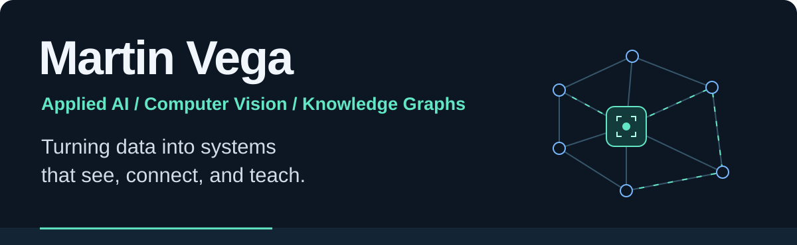
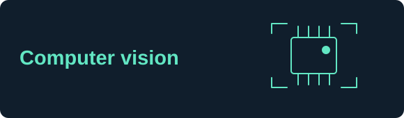
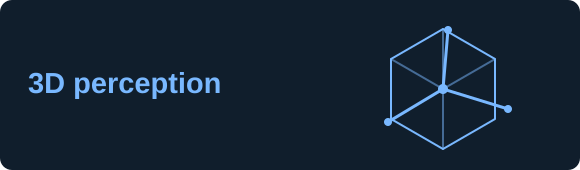
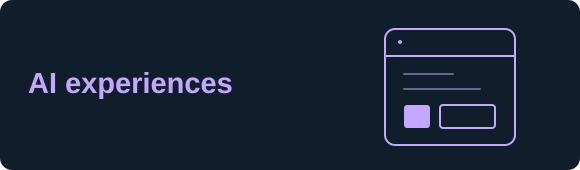

  

  
  
  
  

### Hi, I'm Martin.

I'm a **Senior AI Engineer with a Master's in Data Science from Universidad de Sonora**, working across industrial AI, computer vision, and MLOps.

I build AI projects that connect **models, data, and applications**—from visual defect detection and 3D perception to knowledge graphs and interactive learning tools.

My focus is the full path: **prepare the data → integrate the model → evaluate the behavior → build the application.**

- **Computer vision:** visual inspection, stereo depth, and 6D pose tracking.
- **Connected data:** semantic modeling, provenance, and tools for AI agents.
- **AI applications:** APIs, generative interfaces, and learning experiences.

## My toolbox

  

  
  
  
  

## Selected projects

<table>
<tr>
<td width="50%" valign="top">

### [qc-vision-inspector](https://github.com/MJVNOR/qc-vision-inspector)

Visual defect detection on the **MVTec AD transistor subset**, comparing DINOv2, PatchCore, EfficientAD, and model fusion.

**Inside:** experiment design, threshold calibration, robustness evaluation, and MLflow tracking.

`Python` `PyTorch` `scikit-learn` `MLflow`

[Explore the experiments →](https://github.com/MJVNOR/qc-vision-inspector)

</td>
<td width="50%" valign="top">

### [deephpose](https://github.com/MJVNOR/deephpose)

**Stereo depth and 6D pose tracking** with RealSense D415, FoundationStereo, and FoundationPose, plus segmentation for initialization and recovery.

**Inside:** camera/model integration, GPU resource management, and benchmarks on reference sequences.

`Python` `PyTorch` `OpenCV` `RealSense`

[Explore the pipeline →](https://github.com/MJVNOR/deephpose)

</td>
</tr>
<tr>
<td width="50%" valign="top">

### [MEX-Ontologi](https://github.com/MJVNOR/mex-ontologia)

A **knowledge graph for Sonora's open data**, connecting datasets, resources, columns, and definitions while preserving provenance and source context.

**Inside:** semantic modeling, data pipelines, SHACL validation, and read-only agent queries through MCP.

`Python` `RDF` `SPARQL` `SHACL` `MCP`

[Explore the knowledge graph →](https://github.com/MJVNOR/mex-ontologia)

</td>
<td width="50%" valign="top">

### [CognitiveFlow AI](https://github.com/MJVNOR/CognitiveFlow-AI)

An **active-learning MVP** with an AI tutor, generative interfaces, and an evaluation workflow with explicitly labeled simulation modes.

**Inside:** Flutter/FastAPI integration, interface contracts, persistence, and automated tests. Deployment and the student pilot are pending.

`Flutter` `Dart` `FastAPI` `SQLAlchemy` `Gemini`

[Explore the application →](https://github.com/MJVNOR/CognitiveFlow-AI)

</td>
</tr>
</table>

## How I build

**Evidence first.** Preserve sources and configurations so results can be checked.  
**Evaluate in context.** Document what was measured, simulated, or tested with hardware.  
**Make it reproducible.** Pin environments and provide scripts, tests, and experiment records.  
**Connect the pieces.** Bring models into cameras, APIs, interfaces, and agent tools.

## GitHub activity

---

<strong>Explore the code. Follow the experiments. See how the pieces fit.</strong>

<a href="https://github.com/MJVNOR?tab=repositories">Browse all repositories →</a>

Profile design credits

Inspired by [Beautify GitHub Profile](https://github.com/rzashakeri/beautify-github-profile). Technology icons by [Skill Icons](https://github.com/tandpfun/skill-icons), badges by [Shields.io](https://shields.io), and contribution visualization by [GitHub Profile Summary Cards](https://github.com/vn7n24fzkq/github-profile-summary-cards). Custom SVG artwork is stored in this repository.

